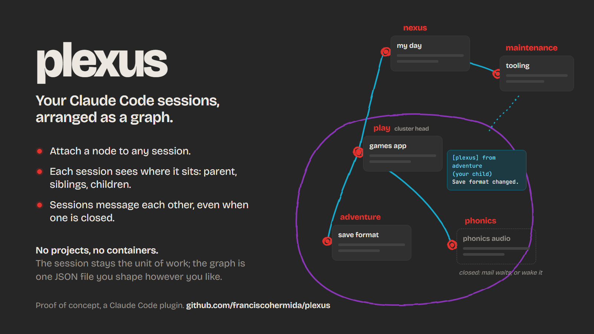

# plexus



**plexus turns your Claude Code sessions into a graph.** You attach a node to a session, and that
session now knows where it sits: who it reports to, who works beside it and beneath it. Sessions
can message each other, even when one of them is closed.

That's all it adds. A session stays a session: no projects, no containers, nothing to migrate
into. The graph is one small JSON file, and you can shape it however you like: one tree or many,
long-lived sessions at the top, short-lived ones beneath, clusters inside clusters.

> **Proof of concept.** It works and it's small (one plugin, a few hundred lines), but it's an
> experiment. It's built on Claude Code [mods](https://code.claude.com/docs/en/plugins/mods/overview),
> which are early access.

## How it works

1. **Attach a node.** In any session, `/node adventure`. The session keeps its own name; the node
   is its role in the graph.
2. **Shape the graph.** `~/.claude/plexus/graph.json` says who is under whom. Edit it by hand, or
   ask any session to. Changes apply at each session's next turn.
3. **Each session sees its place.** A bound session's system prompt carries its node, parent,
   cluster head, children, siblings, and which nodes further up aren't its business.
4. **Sessions talk.** Claude sends to a node by name. An open session gets the message right away.
   A closed one gets it in its mailbox, delivered when a session holds the node again, or now, if
   you `/wake` it.

```text
nexus                 you: todos, everything that spans projects
├── play  (head)      the games app; everything under it escalates here
│   ├── adventure
│   └── phonics
└── maintenance       tooling; anything under play reports here about tooling
```

Ask `adventure` something only `play` knows, and it asks `play`. Change something that breaks
`phonics`, and `adventure` tells it. `nexus` is `play`'s contact, so `adventure` leaves it alone
unless you say otherwise.

## Install

Requires Claude Code 2.1.287 or later, with sessions on the same machine.

```bash
git clone https://github.com/franciscohermida/plexus
claude plugin marketplace add ./plexus
claude plugin install plexus@plexus
```

New sessions load it on their own. A session that's already open picks it up with `/reload-plugins`.

It runs from your clone, so it's yours to change: edit the files, then `/reload-plugins` in the
sessions that should run your version.

## Try it

In three open sessions:

```text
/node nexus
/node play
/node adventure
```

Then give the graph its shape in `~/.claude/plexus/graph.json`:

```json
{
  "nodes": {
    "nexus": { "brief": "Me: todos and everything across projects." },
    "play": { "parent": "nexus", "head": true, "brief": "The games app." },
    "adventure": { "parent": "play", "brief": "The adventure game." }
  },
  "links": []
}
```

Now ask `adventure` to *"tell your parent the save format changed"*. `play` receives a message
starting `[plexus] from adventure (your child)`, and can reply. Run `/graph` to see the whole thing.

## Commands

| | |
| --- | --- |
| `/node <id>` | Attach this session to a node. `/node` alone shows its place. |
| `/graph` | The graph as a tree, with which nodes have a session open. |
| `/wake <id>` | Resume a closed node's last session in the background, so it reads its mail. |

Claude gets the tools `mcp__plexus__send` and `mcp__plexus__graph`, plus a `plexus` skill for
creating, moving and retiring nodes, and for deciding when work deserves its own session.
`mcp__plexus__wake` lets Claude wake nodes itself, but only if you add an allow rule for it:
waking spends usage, so by default it asks you to run `/wake`.

## The graph file

- **`nodes`**: each can have a `parent`, `head: true`, and a `brief` (what its neighbours read about
  it). Ids are letters, digits, `-`, `_`, `.` and `/`. A path id like `play/adventure` implies its
  parent; a flat id like `adventure` declares one. Flat ids are easier to move: a move changes one
  field.
- **`head: true`** makes a node's subtree a cluster that escalates to it.
- **`links`**: a standing reason to talk across the tree, like
  `{ "from": "play/*", "to": "maintenance", "when": "tooling" }`. `play/*` means everything under
  `play`.

Everything plexus keeps is plain JSON in `~/.claude/plexus/` (or `$CLAUDE_CONFIG_DIR/plexus`):
the graph, `sessions/` (which session holds which node) and `mail/` (one file per waiting
message).

## Good to know

- **Sessions are found by id, never by name.** plexus never renames a session.
- **Messages use Claude Code's own [cross-session messaging](https://code.claude.com/docs/en/cross-session-messaging).**
  Every message starts a turn in the receiving session, so the prompt tells sessions to send only
  when it changes the other's work, answers its question, or you asked.
- **Prompt cache.** A session's place text changes when its neighbourhood does (a new child, an
  edited brief), and that session re-caches its conversation once on its next turn.
- **Background sessions** (from `/wake` or `claude --bg`) show in the Desktop app and in
  `claude agents`, not in the VS Code extension's list.
- **No permissions between nodes yet.** The graph shapes what sessions know and how they behave;
  any session can still message any other.

## Developing

```bash
claude plugin validate .
claude plugin test .
```

`hooks/graph.ts` is the graph logic, pure and tested. `hooks/register.ts` is everything that touches
Claude Code (a mod may only pass its `$` API to functions in the same file). `skills/plexus/` is the
skill, `docs/visual.html` the image above. The editor types in `.claude-plugin/types/` appear once
Claude Code has loaded the plugin; for a tight loop, run `claude --plugin-dir ./plexus`.

## License

MIT
